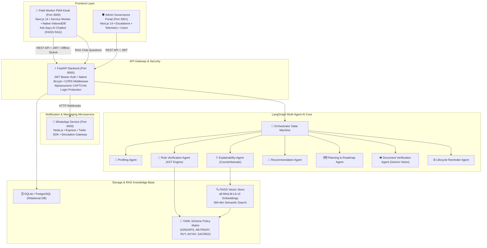
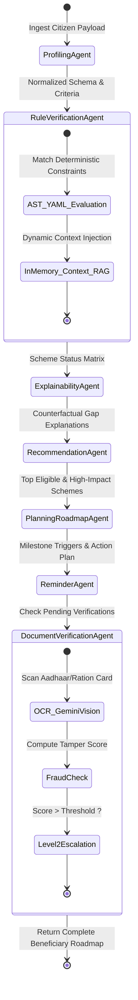

# 🛡️ Aayu AI (आयु)
### *Agentic AI-Driven Continuous Welfare Access & Renewal Assistance for India's Elderly*

[](https://fastapi.tiangolo.com)
[](https://nextjs.org)
[](https://web.dev/progressive-web-apps/)
[](https://langchain-ai.github.io/langgraph/)
[](https://groq.com)
[](https://ai.google.dev/)
[](https://github.com/facebookresearch/faiss)
[](https://twilio.com)
[](https://opensource.org/licenses/MIT)

---

## 🌍 Live Demo (Vercel + Render)

Our production deployment is currently live! You can test the end-to-end functionality right now:

- **📱 Field Worker PWA Dashboard**: [https://aayu-ai.vercel.app](https://aayu-ai.vercel.app)
- **🛡️ Admin Governance Portal**: [https://aayu-ai-d742.vercel.app](https://aayu-ai-d742.vercel.app)
- **⚡ Backend API (Render)**: [https://aayu-ai-backendsamo.onrender.com](https://aayu-ai-backendsamo.onrender.com)

> [!NOTE]
> **Local vs. Cloud Functionality**: Due to the strict 512MB RAM limitation on the free Render tier, the heavy `sentence-transformers` PyTorch model used for the FAISS RAG Search ("Ask Aayu") is automatically bypassed in the cloud deployment to prevent memory crashes. **However, when running locally on your PC (as detailed below), all AI models and RAG pipelines are 100% active and fully functional.**

---

## 📖 Table of Contents
1. [Executive Summary & Problem Statement](#-executive-summary--problem-statement)
2. [Key Capabilities & Innovation](#-key-capabilities--innovation)
3. [End-to-End System Architecture](#-end-to-end-system-architecture)
4. [Multi-Agent Execution Topology (LangGraph)](#-multi-agent-execution-topology-langgraph)
5. [FAISS Semantic RAG Engine & Ask Aayu Chatbot](#-faiss-semantic-rag-engine--ask-aayu-chatbot)
6. [Offline-First PWA & IndexedDB Architecture](#-offline-first-pwa--indexeddb-architecture)
7. [WhatsApp & Proactive Proxy Notification Microservice](#-whatsapp--proactive-proxy-notification-microservice)
8. [Three-Tier Human-In-The-Loop (HITL) Governance](#-three-tier-human-in-the-loop-hitl-governance)
9. [Supported Government Welfare Schemes](#-supported-government-welfare-schemes)
10. [Authentication & Security (RBAC)](#-authentication--security-rbac)
11. [Project Directory Layout](#-project-directory-layout)
12. [API Specification & Endpoints](#-api-specification--endpoints)
13. [Local Development & Setup Guide](#-local-development--setup-guide)
14. [Docker Deployment](#-docker-deployment)
15. [Future Roadmap](#-future-roadmap)

---

## 🎯 Executive Summary & Problem Statement

Over **140 million senior citizens** live in India, a demographic expected to double by 2050. Despite numerous high-impact central and state welfare initiatives (old-age pensions, universal 70+ healthcare coverage, subsidized assistive living devices), **over 62% of eligible seniors never receive their rightful benefits** due to:
- **Severe Digital Divide**: Complex online portals requiring English literacy and smartphone agility.
- **Intermittent Rural Connectivity**: Anganwadi field workers traveling to remote hamlets with zero cellular reception.
- **Fragmented Eligibility Rules**: Complex, multi-variable criteria (age tiers, BPL income thresholds, domicile rules, caste categories).
- **Document Tamper & Verification Friction**: Name mismatches between Aadhaar cards and ration cards leading to silent rejections.
- **Silent Welfare Expiry & Dropouts**: Failure to submit annual life certificates (*Jeevan Pramaan*) or income renewals.

**Aayu AI** is a multi-agent AI ecosystem that transforms passive government welfare into **proactive, continuous, lifelong assistance**. It equips Anganwadi and field staff with an offline-first PWA kiosk while providing district administrators with real-time grievance escalation, user management, and AI pipeline telemetry.

---

## 🌟 Key Capabilities & Innovation

* 🤖 **Multi-Agent Orchestration (LangGraph)**: 8 specialized autonomous agents collaborating on state graphs with Human-In-The-Loop checkpoints.
* 🧠 **FAISS Semantic RAG Engine**: Full Retrieval-Augmented Generation powered by Facebook's `faiss-cpu` and `sentence-transformers (all-MiniLM-L6-v2)`. Automatically indexes all welfare scheme YAML definitions at startup and performs semantic vector search at query time — enabling any type of natural-language question to be answered from the knowledge base.
* 💬 **"Ask Aayu" Floating Chat Assistant**: A beautiful, real-time floating chatbot widget embedded in the Field Worker Kiosk. Field workers can ask any question about scheme eligibility, benefits, or required documents and receive AI-generated answers grounded exclusively in official policy definitions.
* 🔊 **Audio Assist (Text-to-Speech)**: Integrated native Web Speech API in the "Ask Aayu" widget to read AI responses aloud for elderly accessibility, with zero external dependencies.
* 📄 **Export PDF Receipt**: Generates a styled, print-ready PDF summary of a citizen's eligibility results and actionable counterfactuals directly from the dashboard.
* ⚡ **Offline-First PWA with Native IndexedDB**: Complete offline kiosk support enabling field workers to onboard beneficiaries in remote zero-connectivity villages. Automatically queues drafts, pre-caches scheme criteria, and syncs seamlessly when connection is restored.
* 📱 **Twilio WhatsApp Notification Microservice**: Proactive lifecycle reminders, Jeevan Pramaan submission alerts, and application status updates dispatched directly to family proxies. Includes an automated simulation engine for zero-cost local testing.
* 📜 **Dual-Layer Deterministic Rules + Semantic RAG**: AST-based YAML expression evaluation for zero-hallucination legal accuracy combined with FAISS vector semantic search over scheme policy definitions.
* 🔍 **Counterfactual Explainability Engine**: Plain-language explanations detailing not just *why* an applicant was rejected, but *the exact actionable steps* required to qualify (e.g., *"If you update your income certificate to below ₹2,00,000, you immediately unlock ₹1,000/mo pension"*).
* 🗺️ **Cross-Scheme Dependency Roadmap**: Automatically sequences benefits chronologically (e.g., Step 1: Aadhaar DoB correction → Step 2: IGNOAPS Pension → Step 3: AB-PMJAY Universal Healthcare → Step 4: RVY Assistive Device).
* 👁️ **Gemini Vision Optical Verification & Fraud Sentinel**: OCR document parsing using `gemini-2.5-flash` with automated name-matching, blur detection, and tamper flagging.
* 🔐 **Alphanumeric CAPTCHA Security**: Both the Field Worker and Admin portals feature randomized 6-character alphanumeric CAPTCHA challenges on their login pages to prevent automated bot access.
* 👥 **User & Role Management**: Administrative interface for managing Field Workers, District Admins, and System Admins with full editing capabilities.
* 📊 **100% Real-Time AI Pipeline Telemetry**: Live hardware metrics (CPU%, RAM RSS, Uptime) and roundtrip database latency monitoring (`SELECT 1` ping < 1ms).

---

## 🏗️ End-to-End System Architecture



---

## 🤖 Multi-Agent Execution Topology (LangGraph)

The core decision engine runs as a compiled **LangGraph StateGraph** consisting of 8 specialized agents:



| Agent | Responsibility | Implementation File |
| :--- | :--- | :--- |
| **`ProfilingAgent`** | Normalizes raw field worker inputs, standardizes age/income, and extracts verification tags. | `backend/app/agents/profiling_agent.py` |
| **`RuleVerificationAgent`** | Evaluates deterministic YAML rules via Python AST and queries the FAISS knowledge base for ambiguous clauses. | `backend/app/agents/rule_verification_agent.py` |
| **`ExplainabilityAgent`** | Generates human-readable counterfactuals explaining exact requirements to unlock benefits. | `backend/app/agents/explainability_agent.py` |
| **`RecommendationAgent`** | Ranks qualifying welfare programs based on financial impact, urgency, and category. | `backend/app/agents/recommendation_agent.py` |
| **`PlanningAgent`** | Synthesizes a chronological, dependency-aware welfare adoption roadmap. | `backend/app/agents/planning_agent.py` |
| **`DocumentVerificationAgent`** | Uses Gemini Vision (`gemini-2.5-flash`) for OCR extraction, blur analysis, and tamper detection. | `backend/app/agents/document_verification_agent.py` |
| **`ReminderAgent`** | Calculates proactive triggers (e.g. Life Certificate due date, age milestone 70). | `backend/app/agents/reminder_agent.py` |
| **`Orchestrator`** | LangGraph StateGraph engine compiling and coordinating execution across all nodes. | `backend/app/agents/orchestrator.py` |

---

## ⚡ Offline-First PWA & IndexedDB Architecture

The **Field Worker Dashboard** is engineered to operate seamlessly in remote Indian villages with zero cellular reception. Here is how it works:

### 1. Installable App (No App Store Needed)
Because we configured a `manifest.json` and a Service Worker (`sw.js`), the web app can be "Installed" directly to the field worker's phone or tablet home screen. It behaves exactly like a native Android/iOS app without needing to go through the Google Play Store or Apple App Store.

### 2. 100% Offline Access
When the worker is in a village with no cellular data:
* **UI Caching**: The Service Worker implements Stale-While-Revalidate caching for application shells, styles, and routes. The app loads instantly even with airplane mode on.
* **Offline Saving**: When they fill out the registration form for a senior citizen and hit submit, the app detects that they are offline. Instead of trying to send it to the server (which would fail), the data is safely serialized and saved to the device's local **IndexedDB** using our custom `OfflineStorageManager` (`lib/offline-db.ts`).
* **Offline Scheme Cache**: Pre-caches welfare scheme rules and benefits so Anganwadi workers can consult criteria in the field without connectivity.
* **Sync Hub & Auto-Sync Engine**: The app has a dedicated "Offline Sync Hub" page. When the worker returns to a town with internet access, they can open this page to push drafts, or rely on the Auto-Sync Engine (`components/PWARegistration.tsx`) which listens for network reconnect events and automatically pushes saved drafts to the backend server in a batch without user intervention.

This ensures that critical welfare work is never blocked by poor infrastructure!

---

## 📱 WhatsApp & Proactive Proxy Notification Microservice

Located in `whatsapp-service/`, this Node.js microservice acts as an omnichannel communications gateway for senior citizens' family proxies:

* **Real Twilio Integration**: Dispatches formatted WhatsApp messages using the Twilio Node.js SDK when credentials are provided in `.env`.
* **Zero-Cost Simulation Engine**: Gracefully falls back to formatted, timestamped console logs during local development if Twilio keys are omitted.
* **FastAPI Interoperability**:
  - `POST /api/notify/application-status`: Dispatches real-time approval, escalation, or rejection notices.
  - `POST /api/notify/reminder`: Dispatches proactive reminders (e.g., Annual Jeevan Pramaan submission due, 70th Birthday universal healthcare upgrade).
  - `POST /api/notify/action-required`: Sends plain-language explainability instructions to family members.

---

## 🛡️ Three-Tier Human-In-The-Loop (HITL) Governance

```mermaid
flowchart LR
    L1["Tier 1: Anganwadi Field Worker\nTablet Kiosk • Onboarding • Doc Upload"] -->|Auto Pass (< 0.15 Discrepancy)| AutoApprove["✅ Direct Processing"]
    L1 -->|Discrepancy / Name Mismatch| L2["Tier 2: District Admin\nManual Override • Legal Review"]
    L2 -->|Policy Conflict / System Fraud| L3["Tier 3: State / System Admin\nRule Matrix Update • Telemetry Oversight"]
```

---

## 🏛️ Supported Government Welfare Schemes

1. **IGNOAPS (Indira Gandhi National Old Age Pension Scheme)**: ₹500 - ₹1,000/mo social security for BPL citizens aged 60+.
2. **AB-PMJAY Senior Citizen Universal Healthcare**: ₹5,00,000 annual cashless hospitalization coverage for **all citizens aged 70+** regardless of income.
3. **Rashtriya Vayoshri Yojana (RVY)**: Free assistive devices (spectacles, walking sticks, wheelchairs, hearing aids, dentures) for BPL seniors.
4. **Varishtha Mediclaim**: Comprehensive healthcare insurance covering hospitalization and critical illnesses for seniors aged 60–80.
5. **SACRED & AVYAY Portals**: Senior Citizen Employment and Active Aging platforms.

---

## 🔍 FAISS Semantic RAG Engine & Ask Aayu Chatbot

Aayu AI implements a **full production-grade Retrieval-Augmented Generation (RAG) pipeline** using Facebook's FAISS vector library and `sentence-transformers`.

### How it works

```
User Question (natural language)
        │
        ▼
[1. EMBED]  all-MiniLM-L6-v2 encodes query → 384-dim float32 vector
        │
        ▼
[2. RETRIEVE]  FAISS IndexFlatIP performs cosine similarity search
               → Returns Top-4 most semantically relevant scheme chunks
        │
        ▼
[3. AUGMENT]  Retrieved chunks injected into Groq LLM prompt as grounded context
        │
        ▼
[4. GENERATE]  Llama-3.3-70b generates accurate, hallucination-free answer
```

### Knowledge Ingestion at Startup
On every backend boot, the `lifespan` event automatically:
1. Reads all YAML scheme policy files from `backend/app/rules_engine/schemes/`.
2. Converts each file into rich, human-readable text chunks (overview, eligibility, benefits, required documents).
3. Embeds each chunk with `all-MiniLM-L6-v2` (384 dimensions).
4. Builds a FAISS `IndexFlatIP` (inner product = cosine on normalized vectors).

### Ask Aayu Chatbot
A floating chat widget (`ChatAssistant.tsx`) is embedded in the Field Dashboard. Field workers can type any question:
- *"Who qualifies for Rashtriya Vayoshri Yojana?"*
- *"What documents does a 62-year-old widow need for IGNOAPS?"*
- *"What is the pension amount for a person aged 80?"*

Answers are retrieved semantically — not from a static FAQ, but from the live FAISS index.

---

## 🔐 Authentication & Security (RBAC)

* **JWT Bearer Token Architecture**: Native FastAPI token verification (`HS256`).
* **Cryptographic Password Hashing**: Native `bcrypt` algorithm.
* **Alphanumeric CAPTCHA Protection**: Both login portals display a randomized 6-character CAPTCHA on every visit. The character set excludes visually ambiguous characters (`I`, `O`, `0`, `1`). Input is case-insensitive with auto-uppercase styling. A new challenge is generated on every failed attempt.
* **Role-Based Access Control (RBAC)**:
  - `FIELD_WORKER`: Access to Field Dashboard, citizen onboarding, document upload, and local offline sync.
  - `DISTRICT_ADMIN`: Access to District Escalations queue and mismatch resolution.
  - `SYSTEM_ADMIN`: Full system access, User Management (`/users`), live hardware telemetry, and policy rule editing.

---

## 📂 Project Directory Layout

```
vayosetu/
├── backend/                            # FastAPI Python Backend
│   ├── app/
│   │   ├── agents/                     # LangGraph multi-agent modules
│   │   ├── api/v1/                     # REST API route controllers
│   │   │   ├── auth.py                 # JWT Auth, User Management & Edit APIs
│   │   │   ├── citizens.py             # Citizen CRUD
│   │   │   ├── eligibility.py          # Orchestration pipeline triggers
│   │   │   ├── applications.py         # Application management
│   │   │   ├── documents.py            # OCR Document verification
│   │   │   ├── reminders.py            # Lifecycle trigger scheduling
│   │   │   └── admin_system.py         # Real Hardware Telemetry & Rules APIs
│   │   ├── core/                       # Security & JWT logic
│   │   ├── db/                         # SQLAlchemy session & SQLite/PostgreSQL init
│   │   ├── models/                     # Database models & Pydantic schemas
│   │   ├── rag/                        # FAISS semantic vector search engine
│   │   │   ├── vector_store.py         # FAISSVectorStore with all-MiniLM-L6-v2 embeddings
│   │   │   ├── ingestion.py            # Startup YAML → chunk → embed → index pipeline
│   │   │   └── retriever.py            # Scheme retriever interface
│   │   ├── services/
│   │   │   ├── rag_service.py          # RAG orchestrator: retrieve → augment → generate
│   │   │   └── citizen_service.py      # Citizen CRUD service
│   │   ├── rules_engine/               # Deterministic AST evaluator & YAML schemas
│   │   │   └── schemes/                # IGNOAPS, AB_PMJAY, RVY, AVYAY, SACRED YAMLs
│   │   ├── config.py                   # Environment configuration settings
│   │   └── main.py                     # FastAPI application entrypoint (FAISS lifespan)
│   ├── requirements.txt                # Python backend dependencies
│   └── vayosetu.db                     # SQLite development database
│
├── frontend-field-dashboard/           # Next.js 14 Offline-First PWA Kiosk
│   ├── app/
│   │   ├── page.tsx                    # Main interactive field dashboard
│   │   ├── login/                      # Field worker authentication
│   │   ├── register/                   # Citizen registration kiosk
│   │   ├── citizens/                   # Directory of registered seniors
│   │   ├── documents/                  # Optical document verification upload
│   │   ├── applications/               # Application status & tracking
│   │   └── offline-sync/               # IndexedDB Sync Hub & Scheme Pre-caching
│   ├── components/
│   │   ├── Navigation.tsx              # App header with Shield icon & Aayu AI branding
│   │   ├── ChatAssistant.tsx           # Floating FAISS RAG chat widget (Ask Aayu AI)
│   │   └── PWARegistration.tsx         # Service Worker & auto-sync engine
│   ├── lib/
│   │   ├── api-client.ts               # Axios HTTP client (JWT interceptor)
│   │   ├── offline-db.ts               # Native IndexedDB engine
│   │   └── auth.ts                     # Login/logout utilities
│   └── public/                         # PWA manifest.json, sw.js, SVG icons
│
├── frontend-admin-panel/               # Next.js 14 Admin Governance Portal
│   ├── app/
│   │   ├── dashboard/                  # Administrative analytics overview
│   │   ├── login/                      # Admin secure login
│   │   ├── users/                      # User & Role Management (Add/Edit)
│   │   ├── escalations/                # Level 2 Document mismatch resolution
│   │   ├── scheme-rules/               # Policy rules matrix visualizer
│   │   └── pipeline-health/            # Real-time AI hardware & telemetry gauges
│   ├── components/                     # Navigation & dashboard charts
│   └── lib/                            # Admin Axios API client
│
├── whatsapp-service/                   # Node.js Twilio WhatsApp Microservice
│   ├── src/
│   │   └── index.js                    # Express gateway, Twilio client & Simulation mode
│   └── package.json                    # Node.js dependencies
│
├── voice-service/                      # Regional dialect audio brief service
├── docker-compose.yml                  # Full-stack container orchestration
├── .env.example                        # Environment variables template
└── README.md                           # Master documentation
```

---

## 📡 API Specification & Endpoints

| Category | Method | Endpoint | Description |
| :--- | :--- | :--- | :--- |
| **Auth** | `POST` | `/api/v1/auth/login` | OAuth2 form login returning JWT Bearer token |
| **Auth** | `POST` | `/api/v1/auth/register` | Register a new Field Worker or District Admin |
| **Auth** | `GET` | `/api/v1/auth/users` | List all registered users (passwords excluded) |
| **Auth** | `PUT` | `/api/v1/auth/users/{id}` | Edit an existing user's name, role, or district |
| **RAG Chat** | `POST` | `/api/v1/ask` | **Ask Aayu AI**: FAISS semantic search + Groq LLM answer |
| **Citizens** | `GET` | `/api/v1/citizens/` | Retrieve all registered citizens |
| **Citizens** | `POST` | `/api/v1/citizens/` | Register a new senior citizen profile |
| **Citizens** | `GET` | `/api/v1/citizens/{id}` | Retrieve specific citizen details & profile |
| **Eligibility**| `POST`| `/api/v1/eligibility/evaluate-full/{id}` | **Run full 8-agent LangGraph execution pipeline** |
| **Applications**| `GET`| `/api/v1/applications/` | List all submitted welfare scheme applications |
| **Applications**| `POST`| `/api/v1/applications/` | Submit an application for an eligible citizen |
| **Escalations**| `GET` | `/api/v1/admin/district/escalations` | Level 2 escalation queue for document mismatches |
| **Escalations**| `POST`| `/api/v1/admin/district/escalations/{id}/resolve`| Resolve escalation or approve mismatch override |
| **Telemetry** | `GET` | `/api/v1/admin/system/pipeline-health` | **Live hardware, DB ping latency & agent status** |
| **Rules** | `GET` | `/api/v1/admin/system/rules` | Retrieve loaded policy rules from disk |
| **WhatsApp** | `POST` | `http://localhost:4000/api/notify/*` | Dispatches lifecycle alerts to family proxies |

---

## 🚀 Local Development & Setup Guide

### 1. Prerequisites
- **Python**: `3.10` or higher (tested with `3.13`)
- **Node.js**: `18.x` or higher
- **Groq API Key**: (Optional for LLM features, get from [console.groq.com](https://console.groq.com))

### 2. Environment Configuration
Create a `.env` file in the `backend/` directory:
```bash
# backend/.env
PROJECT_NAME="Aayu AI API"
DATABASE_URL="sqlite:///./aayu_ai.db"
SECRET_KEY="super-secret-aayu-ai-jwt-key"
GROQ_API_KEY="your_groq_api_key_here"
GROQ_MODEL="llama-3.3-70b-versatile"
GOOGLE_API_KEY="your_google_gemini_api_key_here"
```

### 3. Backend Setup (FastAPI)
```bash
# Navigate to backend directory
cd backend

# Create and activate virtual environment
python -m venv venv
# On Windows:
venv\Scripts\activate
# On Linux/macOS:
source venv/bin/activate

# Install dependencies
pip install -r requirements.txt
pip install psutil bcrypt faiss-cpu sentence-transformers torch transformers

# Start FastAPI server (FAISS RAG index is built automatically on startup)
uvicorn app.main:app --reload --host 0.0.0.0 --port 8000
```
- API Base: `http://localhost:8000`
- Interactive Swagger API Docs: `http://localhost:8000/docs`

### 4. Field Worker PWA Dashboard (Port 3000)
```bash
# In a new terminal:
cd frontend-field-dashboard
npm install
npm run dev -- -p 3000
```
- Web URL: `http://localhost:3000`
- Features: Offline PWA, IndexedDB sync hub, touch registration kiosk.

### 5. Admin Governance Portal (Port 3001)
```bash
# In a new terminal:
cd frontend-admin-panel
npm install
npm run dev -- -p 3001
```
- Web URL: `http://localhost:3001`
- Features: User Management, Live Telemetry, Document Escalations, Rule Matrix.

### 6. WhatsApp Notification Microservice (Port 4000)
```bash
# In a new terminal:
cd whatsapp-service
npm install
npm start
```
- Microservice URL: `http://localhost:4000`
- Features: Outgoing Twilio WhatsApp notifications + interactive local simulation console.

---

## ☁️ Cloud Deployment Guide (Vercel & Render)

If a new user wants to deploy this entire architecture to the cloud exactly as we have, follow these configurations:

### 1. Backend API (Render)
- **Service Type**: Web Service
- **Root Directory**: `backend`
- **Environment**: `Python 3`
- **Build Command**: 
  ```bash
  pip install -r requirements.txt && pip install python-multipart
  ```
- **Start Command**: 
  ```bash
  uvicorn app.main:app --host 0.0.0.0 --port $PORT
  ```
- **Required Environment Variables**:
  - `SECRET_KEY`: Any secure cryptographic string (e.g. `super-secret-key`)
  - `GROQ_API_KEY`: Your key from Groq Console
  - `GOOGLE_API_KEY`: Your key from Google Gemini AI

### 2. Frontend Dashboards (Vercel)
Import the root repository into Vercel twice (once for each app):

- **Field Worker Dashboard**:
  - **Framework Preset**: `Next.js`
  - **Root Directory**: `frontend-field-dashboard`
  - **Environment Variables**: Add `NEXT_PUBLIC_API_URL` pointing to your deployed Render URL.

- **Admin Governance Portal**:
  - **Framework Preset**: `Next.js`
  - **Root Directory**: `frontend-admin-panel`
  - **Environment Variables**: Add `NEXT_PUBLIC_API_URL` pointing to your deployed Render URL.

---

## 🐳 Docker Deployment

To launch all microservices and database containers simultaneously with Docker Compose:

```bash
docker-compose up --build -d
```

Services exposed:
- **Backend API**: `http://localhost:8000`
- **Field Dashboard (PWA)**: `http://localhost:3000`
- **Admin Panel**: `http://localhost:3001`
- **WhatsApp Gateway**: `http://localhost:4000`

---

## 🔮 Future Roadmap

- [x] **Offline Progressive Web App (PWA)**: Full offline-first IndexedDB synchronization engine for remote villages without internet.
- [x] **WhatsApp Family Proxy Gateway**: Automated proactive lifecycle alerts and reminder dispatches.
- [x] **Administrative User Management**: Role assignment and user configuration interface.
- [x] **FAISS Semantic RAG Engine**: Full vector-based retrieval-augmented generation with `all-MiniLM-L6-v2` embeddings and FAISS indexing.
- [x] **Ask Aayu Floating Chatbot**: Real-time RAG-powered chat assistant for field workers embedded directly in the kiosk interface.
- [x] **Audio Assist (Text-to-Speech)**: Native voice playback for chatbot responses.
- [x] **Export PDF Receipts**: Downloadable and printable eligibility result summaries.
- [x] **Alphanumeric CAPTCHA Login Security**: Bot-resistant randomized challenge on both login portals.
- [ ] **DigiLocker Direct Integration**: Automated direct fetching of verified Aadhaar and Income Certificates via DigiLocker API.
- [ ] **Bhashini Voice AI Integration**: Native Indian regional speech-to-speech interaction engine across 22 official languages.
- [ ] **Jeevan Pramaan Biometric Bridge**: RD-service biometric fingerprint authentication for seamless annual digital life certificates.

---

## 🛠️ Recent System Patches & Updates

During our latest audit and optimization pass, the following critical improvements were made:
- **FAISS RAG Upgrade**: Replaced in-memory context-dump RAG with a proper FAISS `IndexFlatIP` vector store. Scheme YAML files are automatically chunked, embedded with `sentence-transformers (all-MiniLM-L6-v2)`, and indexed at every backend startup.
- **Ask Aayu Chat Widget**: Added a floating AI chatbot (`ChatAssistant.tsx`) to the Field Dashboard. Field workers can ask natural-language questions about scheme eligibility and get semantically retrieved, LLM-generated answers.
- **Accessibility & Records**: Added an Audio Assist (Text-to-Speech) toggle to the Ask Aayu chatbot and a "Download PDF" receipt generator for eligibility results.
- **CAPTCHA Login Security**: Both login portals now display a randomized 6-character alphanumeric CAPTCHA on every visit, with automatic refresh on failure.
- **Offline Reliability:** Fixed an IndexedDB storage bug where transient initial storage blocks would permanently lock the database until reload. The engine now correctly retries on transient errors.
- **Data Integrity:** Added the missing `has_bpl_card` boolean field to the frontend PWA register form, ensuring strict synchronization with the backend Schema requirements.
- **Security Alignment:** Fixed an environment variable mismatch where the backend security module was incorrectly searching for `JWT_SECRET` instead of the system-wide `SECRET_KEY`.
- **UI/UX Consistency:** Restored missing CSS variables (`.input-field`) for the Admin Governance Portal's user management modal.
- **Notification Personalization:** The WhatsApp microservice now correctly passes real Senior Citizen names in proxy notifications rather than falling back to a hardcoded "Citizen" string.
- **AI Vision Hybrid Architecture:** Switched the Document Verification Agent from Groq's decommissioned LLaMA Vision model to Google's `gemini-2.5-flash` for native OCR. Implemented an honest fallback mechanism that properly escalates unverified non-document images as a FRAUD_ALERT instead of auto-approving them when the AI service is unavailable.
- **End-to-End Application Pipeline:** Integrated a full application lifecycle. Field Workers can now push a "Submit Application" button directly from the AI Eligibility Roadmap. District Admins receive these in a real-time, drag-and-drop **Applications Kanban Board** to review and move them to `APPROVED` or `ESCALATED`.

---

## 📜 License
This project is licensed under the **MIT License**.
Distributed freely to empower welfare access for every senior citizen across India.
